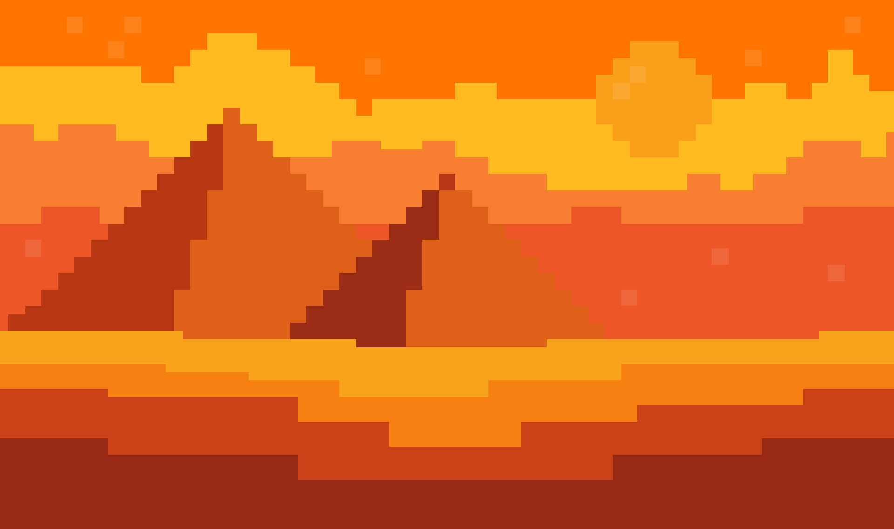

= Cat mummies
:experimental:
:nofooter:
:source-highlighter: pygments
:sectnums:
:stem: latexmath
:toc:
:xrefstyle: short

[[Game-lore]]
== Game Lore
Cat Mummies is a 2D arcade / survival game that creates a fun and enjoyable experience during gameplay,
through unlimited gameplay with an infinite game mode that features the main character Cat.
Cat is stranded in the desert and must fend for itself against mummies who try to attack him.
Cat only carries yarn balls to defend himself, which he throws at mummies. Yarn balls turn out
to be very effective at knocking the mummies down.

Cat does not know when the waves of mummies will stop, but he knows they have no good intentions.
Mummies only have melee attacks, therefore Cat must take advantage
of their weak point by maintaining a good range from them.

== Game specification
Cat Mummies is a single-player desktop video game which is built on C++ and NASM (x86_64 Assembly).
It utilizes Raylib as its base graphics library, and relies on it for all graphic and input actions
available in the game. The game features NASM in its Linux-based release. Therefore, performance may
increase in Linux-based machines.

The core mechanic is time-based survival with score progression. The player is intended to
survive as long as possible. Based on the time passed, the player is rewarded with
a better score on the specific game session it is playing.

=== Key features
- Static arena gameplay
- Enemy waves with multiple difficulty levels (speed and aggressiveness)
- Yarn ball collection as ammunition
- Scoring system with high-score tracking
- Menu interface and scoreboard

== How to play

The player must open the application and navigate through the presented main menu.
The player can navigate the menu utilizing `W` / `UP` keys for going upward, and
`S` / `DOWN` keys for going downward. The player can select and option by pressing the `return` key.

Following these navigation instructions, the player should select the 'Start' option,
which is first in the menu. Once the player enters that option, the application should initiate gameplay.

The game provides the following control interface for the player to use:

- **Movement**: A / D keys (or joystick with Arduino)
- **Jump**: Space bar
- **Shoot**: Mouse left-click
- **Pause**: Esc key

The player will start with only 12 yarn balls as ammunition, but the player may run out of ammo. For that matter,
the player can pick up ammunition that spawns on both ends of the static game screen.

The player must aim at incoming mummies that try to follow him/her, and shoot a yarn ball at them to
knock them down utilizing the mouse `left-click`.
the player can only move sideways using the A / D keys. for left and right
respectively. To make Cat jump, press the `space bar`. Finally, to pause the current game,
the player can press `Esc` key. A pause menu will appear and feature options for the player to select.
The menu follows the same guidelines as the game main menu from the application opening.

=== How to win
To win the game is actually a matter of the players want. The game by itself does not have a finish line,
or a proper end screen. Rather, the game continues indefinitely until the player ultimately fails to
avoid the incoming waves of mummies, and dies.

The player's goal is to survive as long as possible without being touched by any mummy. The game score
may indicate a degree of "winning", in the sense that a higher score may indicate gamer prowess.

Scores are to be tracked by the game, and will be displayed at command in the main menu when the 
correct option is selected. A scoreboard shall appear with the historical best scores in the game,
sorted by highest score and labeled with a date.

The indications summary following the next list:

- Survive waves of mummies appearing from the sides of the arena.
- Collect yarn balls scattered near enemy spawn points to keep your ammo stocked.
- Aim and shoot yarn balls with the mouse to defeat mummies.
- Avoid direct contact — one hit ends the run.
- The longer you stay alive, the higher your score.
- A high-score tracker records your best survival time.

Finally, winning is not about finishing levels, but about setting and breaking your personal best score.

[[assets]]
== Game assets

=== Main menu
image::doc-assets/game-main-menu.png[Game main menu, width=600, align=center]

=== Main character
image::doc-assets/cat.jpeg[Main Cat sprite, width=200, align=center]

=== Main character projectile
image::doc-assets/projectile.jpeg[Cat projectile, width=200, align=center]

=== Enemies
image::doc-assets/mummy-easy.jpeg[Easy mummy enemy sprite, width=200, align=center]
image::doc-assets/mummy-moderate.jpeg[Moderate mummy enemy sprite, width=200, align=center]
image::doc-assets/mummy-hard.jpeg[Hard mummy enemy sprite, width=200, align=center]

[[user_manual]]
== User manual

[[build]]
=== Build

[[game_settings]]
==== Game settings
The game can be played in a windowed and full-screen setting. This setting is not set
in-game, but rather is set in `main.cpp`.

If you prefer a windowed version of the game, change `line 10` using the following syntax:

[source,delphi]
----
Game game(InputSourceType::Keyboard, height_value, width_value, "Cat Mummies");
----

- height_value must be an integer value lower or equal to your screen height resolution.
- width_value must be an integer value lower or equal to your screen width resolution.

If you prefer a full-screen version of the game, change `line 10` using the following syntax:

[source,delphi]
----
Game game(InputSourceType::Keyboard, "Cat Mummies");
----

If you prefer to utilize a joystick for playing the game, change `line 10` using the following syntax:

[source,delphi]
----
Game game(InputSourceType::Joystick, "Cat Mummies");
----

Joystick implementation is still under implementation, therefore it is not currently availble in
the project.

[[building_the_program]]
==== Building the program
Before attempting to build the project, make sure the required dependencies are on the clients
machine, and are their paths are reachable.
Using `make help` provides an interface for all available targets in the Makefile provided,
make sure to follow the set interface.

The following indications are focused on MacOS and Linux-based systems specifically.
Support for machines with Windows, or other operating systems is not supported,
nor there is documentation for those systems relating to this project.

Open a terminal window, and direct to the root of this project. There, to build the game input the
`make` command. This action will compile the source code into object code in a `build/` directory
in the current project and link all that object code into an executable named `Cat mummies` in a
`bin/` directory.

The previous Makefile target provides a standard compilation for the game, but also a
`make release` command is provided by the Makefile interface, to compile a release version of the
game. This target will perform a similar pipeline to `make`, although the executable created is a
release version of the game.

Another useful command, but rather similar to `make` is the `make debug` command, which
is intended to build a debug version of the game. This version is intended for debugging
the program's code.

To clear any compiled files and generated executables, utilize the `make clean` command. This
command will eliminate the `build/` and `bin/` directories in one action.

During development cpplint was utilized for following a set standard in the code.
If you have cpplint in your machine, you can utilize the `make lint` command to perform
a scan on the code. This functionality is an extra, and should not be necessary for compiling
and running the program.

[[usage]]
=== Usage
After following the previous `build` section, and compiling an executable version of the game,
this section will provide a guide on usage of the program.

The Makefile interface provides the `make run` command, which should be used after having
a compiled version of the program. If no compiled executable is available, the target
will compile the game the same way the `make` command does. And after that, it will run
the program.

Another alternative, is to direct to the `bin/` directory in the root of the project and
running the program using the mouse.
This alternative is discouraged because the game assets may go missing and the program
may behave in a weird way.

[[Functionality]]
== Functionality
The following functionalities are intended to be included in the video game.
[cols="2,2,2,2", options="header"]
|===
| Functionality | Control (keys/joystick) | Description | Status

| Lateral Movement
| With Arduino: Joystick Without Arduino: left key A, right key D
| The player moves sideways across the screen.
| 🔄 In progress

| Jump
| Space key
| Allows dodging mummies. Vertical movement only (jump).
| 🔄 In progress

| Yarn Ball Shooting
| Mouse (left click)
| Shoots a projectile toward the cursor. Impact eliminates the mummy.
| ⏳ TBD

| Ammo Collection
| Automatically when touching yarn balls in the scene
| Increases available ammunition.
| ⏳ TBD

| Score
| Automatically with time and when eliminating mummies
| The highest score is saved.
| ⏳ TBD

| Menu Interface
| -
| The main menu that directs to a game session and the report.
| ✅ Finished

| Game Interface
| -
| Sprites of the player and enemies must appear on screen.
| 🔄 In progress

| Pause Button
| Esc key
| Pressing Esc key pauses the current game session.
| ⏳ TBD

| High Score Component
| -
| A component in the main menu displaying the highest historical score.
| ⏳ TBD
|===

== Dependencies
For the client to compile the game utilizing its build features, the following dependencies
must be present in the clients machine:

- Latest gpass:[++] compiler
- NASM Assembly compiler
- System-specific Raylib Graphics library

The g++ compiler is required due to the Makefile only providing an interface for that specific compiler.
The NASM Assembly compiler is necessary for Linux-based builds due to the Makefile establishing
a rigid compilation pipeline.
The Raylib Graphics library is required, as its the backbone of the game, in which it relies
heavily for all the graphic and input actions.

[[credits]]
== Credits

=== Professor
mailto:sleyter.angulo@ucr.ac.cr[MSc. Sleyter Angulo Chavarría]

=== Developers
|===
|Student Name | Student ID

| mailto:carlos.alvaradomeneses@ucr.ac.cr[Carlos Alvarado Meneses] | C4C337

| mailto:jocsan.fernandezsalas@ucr.ac.cr[Jocsan Fernández Salas] | C4F122

| mailto:jason.montenegro@ucr.ac.cr[Jason Montenegro Navarro] | C4H386

| mailto:may.retana@ucr.ac.cr[May Retana Delgado] | C16409
|===
