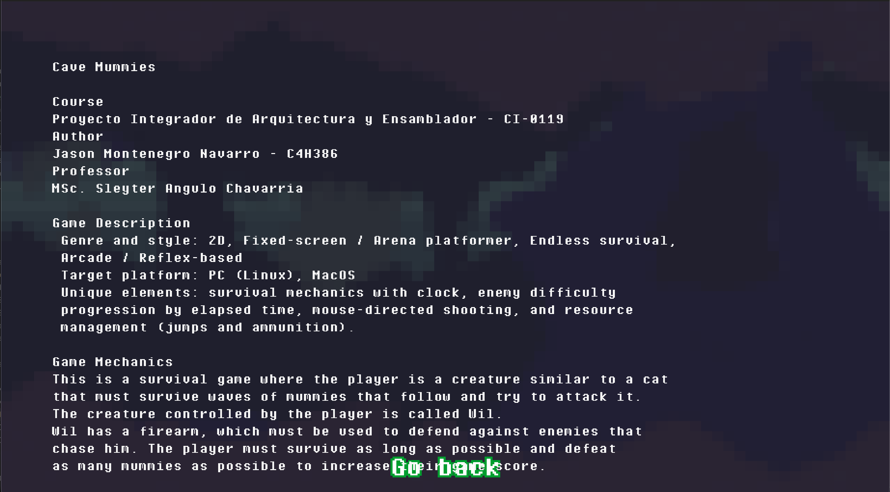
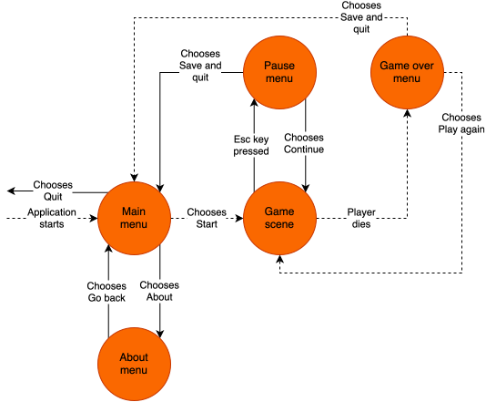

= Cave Mummies
:experimental:
:nofooter:
:source-highlighter: pygments
:stem: latexmath
:toc:
:xrefstyle: short

image:doc-assets/game_main_menu.png[Cave mummies main menu, align=center]

[[Game-lore]]
== Game Lore
Cave Mummies is a **2D arcade/survival** game that creates a fun and enjoyable
experience during gameplay, through **unlimited** game time with an infinite
game mode that features the main character **Wil**.
Wil is a cat-looking creature that appeared one day on his owner's
backyard as a baby. Since then, his owner has taken care of him.
Wil is stranded in a cave where his owner went missing. He's in the search for
him, but encounters himself surrounded by hordes of **mummies** that are
desperate to take him down.
Before Wil's owner went on searching for treasure in the caves, he left Wil a
glock so he could protect himself against any danger. Since it has been a
while since Wil has seen his owner, he starts his journey looking for him taking
the weapon he was given.

Wil does not know when the hordes of mummies will stop, but he knows he has to
survive to see his owner again. Wil discovers they only perform
**melee attacks**, therefore he must take advantage of his ranged weapon.

== Game Specification
Cave Mummies is a single-player desktop video game which is built on 
_Cpass:[++]_ and _NASM_ (x86_64 Assembly). It utilizes the Raylib library as its
graphics and keyboard input library. The game features code implementations in
assembly, directed towards Linux systems using _NASM_ compiler. The game is made
fully with _Cpass:[++]_ in its MacOS release.

The core mechanic of the game is survival with score progression.
The player is intended to survive as long as possible. The player will
accumulate a higher score based on elapsed time and the number of mummies
defeated. The recorded highest game score will be the one while the program
is running. Game scores are not saved or stored when the program is closed.

=== Key features
- Arena gameplay
- Enemy waves with multiple difficulty levels (speed and resistance)
- Player's weapon has limited loaded ammunition
- Elapsed time clock for game sessions
- Scoring system with high-score tracking
- Minimalistic menu interface

== How to Play
image:doc-assets/gameplay_preview_one.png[Gameplay preview, align=center]

At first, the player must navigate through the presented main menu. 
The player can navigate the menu utilizing `W` / `ARROW_UP` keys for going
**upward**, and `S` / `ARROW_DOWN` keys for going **downward**. Or using the
mouse scroll wheel upwards and downwards.
The player can select an option by pressing the `ENTER` key or using the 
`MOUSE_LEFT_CLICK` key anywhere on the screen.

These navigation instructions apply to all menus presented in the game.
Following these navigation instructions, the player should select the **Start** 
option, which is the first in the menu. Once the player selects that option, the
game will initiate. The game provides the following key control interface for
the player to use:

- **Movement**:
- **Left**: `A` / `ARROW_LEFT`
- **Right**: `D` / `ARROW_RIGHT`
- **Run**: `LEFT_SHIFT` (can only be used simultaneously with movement keys)
- **Jump**: `SPACE_BAR` / `W` / `ARROW_UP`
- **Reload**: `R` / `MOUSE_LEFT_CLICK`
- **Shoot**: `MOUSE_LEFT_CLICK`
- **Pause**: `ESC` (can only be used during gameplay)
- **Music**: `M` (toggles the background music)

The player must aim and shoot at incoming enemies that will try to follow them.
Surely shooting with a weapon which has unlimited bullets as ammunition is 
**satisfying**, but there is a limit to how many bullets may be loaded into the 
weapon. The weapon should only yield twelve bullets at a time. After the
remaining loaded bullets are used, the player must wait until the weapon is 
reloaded. Reloading will take two seconds and can only occur once the  magazine
is empty.

This game features compatibility with the Arduino platform enabling movement
with the joystick accessory. To enable this option, you must have a Linux based
machine and should connect an Arduino device with a joystick accesory to your
machine. Movement is just as in many other titles, rolling the joystick
horizontally to the sides moves the player in that direction. Rolling the
joystick upward makes the player jump. Running can be done by pressing the
joystick button down as a toggle for running.

=== How to Win
To win the game is actually a matter of the player's want. The game by itself
does not have a finish line. Rather, the game continues indefinitely until the
player ultimately fails to avoid the incoming waves of enemies, and dies.

To increase the current game score, only two factors can contribute to it:
time elapsed and enemies killed. Elapsed time, as its label implies, refers
to the time elapsed since the start of the gameplay. Each second elapsed
accounts for one extra point to the current game score. A greater enemy kill
count should also grant a better score. For each enemy killed, 10 points
are added to the game score. The player starts out with only two jumps available 
from the moment they are standing on the floor tile. Killing enemies increases
the amount of jumps the player can perform. This jump count can be accumulated,
therefore, the player can accumulate as many jumps as enemies killed.

The player's goal is to survive as long as possible without being reached by an
enemy. The game score may indicate a degree of "winning", in the sense that a
higher score may indicate gamer prowess. In both the paused menu, and game over
screen, an option to go back to the main menu is available. This option records
current game score if its the highest achieved while the game is running.

[[assets]]
== Game Assets

=== Main Menu Screen
image::doc-assets/game_main_menu.png[Game main menu, align=center]

=== About Screen

=== Gameplay Example
image::doc-assets/gameplay_preview_two.png[Gameplay preview, align=center]

=== Paused Game Screen
image::doc-assets/paused_game_screen.png[Paused game screen, align=center]

=== Game Over Screen
image::doc-assets/game_over_screen.png[Paused game screen, align=center]

=== Player Character
image::doc-assets/wil_skin.png[main player character, width=200, align=center]

=== Enemy Set
==== Easy-Moderate Difficulty Enemy
image::doc-assets/easy_enemy_skin.png[Easy-moderate difficulty enemy character, width=200, align=center]

==== Hard Difficulty Enemy
image::doc-assets/hard_enemy_skin.png[Hard difficulty enemy character, width=200, align=center]

[[design]]
== Architectural game design

The previous diagram demonstrates an overview of the architectural design of the
application. The diagram shows a set of nodes which define the different game
states the game has, and also a set of edges which indicate actions performed
by the player.

The diagram shows dashed edges, these are intended to be a predefined path for
the player to go through during their walk through in the game. They can
loop around a series of games after dying, or they can also break this loop and
return back to the main menu.

[[user_manual]]
== User Manual

[[build]]
=== Build

[[building_and_compiling]]
=== Disclaimer
Before attempting to build the project, make sure the required dependencies are
on your machine, and that their paths are reachable. In a terminal, use the
`make help` target and an interface will be displayed with all available targets
provided by the Makefile. Make sure to follow the set interface.

The following indications are focused on MacOS and Linux-based systems
specifically. Support for machines with Windows operating system is not readily
supported, nor there is documentation for those systems relating to this project
in this documentation.

=== Instructions
Previous to the building instructions, use the `make raylib` target, which
clones and builds the raylib dependency for this project to build adequately.
Direct yourself to the root of this project. There, to build the game, run the
default `make` target to build the project. This target will compile the source
code in a directory named `build/` in the root of this directory, and link the
compiled code into an executable named `Cave mummies` in a `bin/` directory.

The previous target mentioned provides a standard compilation for the game,
but also a `make release` target is provided by the Makefile interface
to compile a release version of the game. If you are in a Linux-based system,
always use the default `make` or `make debug` targets, as the `make release`
target may provoke undefined behaviour due to Raylibs's library. If you are in a
MacOS system, you are fine to use the 'make release' target.

To clear any compiled files and binaries, utilize the `make clean` target.
This target will remove the `build/` and `bin/` directories, but will not remove
the `libs/raylib/` directory. To remove the raylib dependency directory,
manually delete the `libs/` directory.

[[usage]]
=== Usage
The Makefile interface provides the `make run` target, which should be used to
run the game. If no compiled executable is available, the target will compile 
the game using the default `make` target.

Another alternative, is to direct yourself to the `bin/` directory in the root
of the project and running the executable file manually. A desktop shortcut
can also be created using the executable file located inside the `bin/` 
directory.

== Dependencies
In order to use the Makefile targets, the following dependency list indicates
what programs are required. All of these dependencies are to be installed suited
to your operating system. There is no guide on how to install these programs in
this documentation.

- gpass:[++] compiler (C++ compiler)
- NASM (Assembly compiler for Linux-based systems)
- Git (version control tool)
- Make (Build tool)
- Cpplint (Linting tool required for 'make lint')
- Doxygen (Documentation tool required for 'make doc')

The Cpplint and Doxygen dependencies are highly optional, and not neccesary to
build the application. They are only for debugging and documentation purposes.

[[credits]]
== Credits

=== Professor
mailto:sleyter.angulo@ucr.ac.cr[MSc. Sleyter Angulo Chavarría]

=== Developer
mailto:jason.montenegro@ucr.ac.cr[Jason Montenegro Navarro] | C4H386

During the development of the application, the AI tool ChatGPT was used to
clarify technical doubts and questions about the Raylib library API. Also the AI
tool Google Gemini was used in Google searches for information about C++ and
diverse topics to develop this project.
