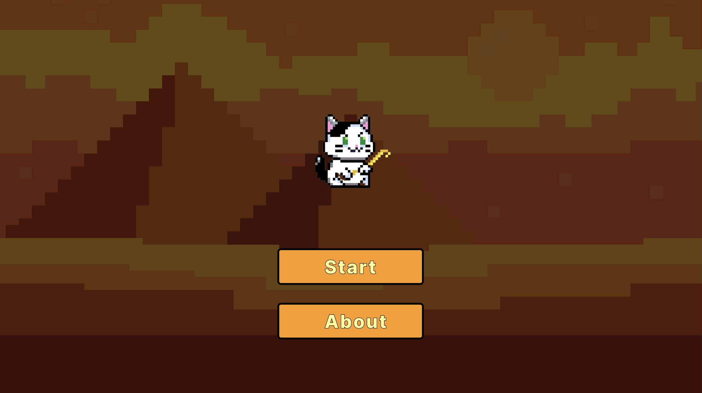
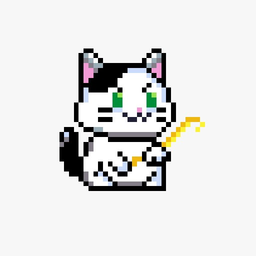
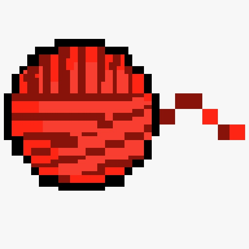
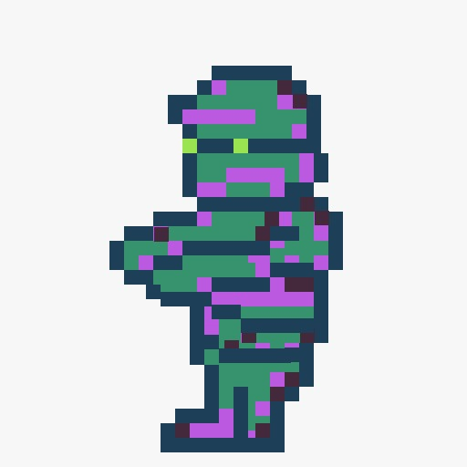
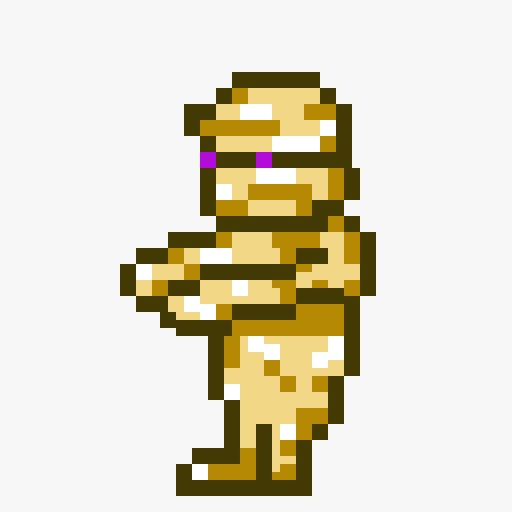
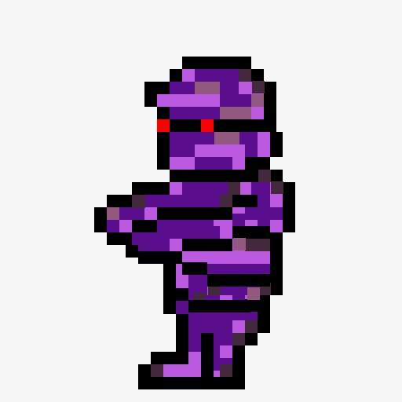

= Cat mummies
:experimental:
:nofooter:
:source-highlighter: pygments
:sectnums:
:stem: latexmath
:toc:
:xrefstyle: short

[[Description]]
== Description 🎮
Cat Mummies is a 2D arcade/survival game built with Raylib (C) for graphics and NASM (x86_64 Assembly) for low-level logic. The player controls a cat that must survive waves of mummies in a fixed-screen arena, using yarn balls as projectiles aimed with the mouse.

- 🎯 Target platform: PC (Linux)
- ⚙️ Core mechanic: time-based survival with score progression.

=== Key features ✨
- 🏟️ Static arena gameplay
- 🌊 Enemy waves with multiple difficulty levels (speed and aggressiveness)
- 🧶 Yarn ball collection as ammunition
- 📊 Scoring system with high-score tracking
- 📱 Basic menu interface and scoreboard

== How to play 🎯

=== Main controls 🎮
- 🏃‍♂️ Movement: A / D keys (or joystick with Arduino)
- 🦘 Jump: Space bar
- 🔫 Shoot: Mouse right-click
- ⏸️ Pause: Esc key
- 🚪 Exit: R key

=== How to win 🏆

The goal of *Cat Mummies* is simple: survive as long as possible without being touched by a mummy.  
Your score increases with time and by eliminating enemies.

- 👻 Survive waves of mummies appearing from the sides of the arena.
- 🧶 Collect yarn balls scattered near enemy spawn points to keep your ammo stocked.
- 🎯 Aim and shoot yarn balls with the mouse to defeat mummies.
- ❌ Avoid direct contact — one hit ends the run.
- ⏱️ The longer you stay alive, the higher your score.
- 📈 A high-score tracker records your best survival time.

Winning is not about finishing levels, but about setting and breaking your personal best score. 💪

[[assets]]
== Game assets 🌠

=== Main menu

=== Main character

=== Main character projectile

=== Enemies

[[user_manual]]
== User manual 📝

[[build]]
=== Build
To build the game, run the `make` command in the terminal at the root of the project. This will compile the source code into object code in a `build/` directory and then link it into an executable named `Cat mummies` in a `bin/` directory. You can build the game using `make release` to optimize the executable for a release build. To delete the compiled files and their respective directories, run the `make clean` command.

[[usage]]
=== Usage
To run the game by terminal, execute the command `make run` at the root of the project. Or else, you could execute the program directly in the `bin/` directory.

To get help using `make` commands, enter `make help` in the terminal.

The project uses cpplint for formatting the source code, which can be tested using `make lint`.
Cpplint is an additional dependency that must be installed in your machine before use.

[[Functionality]]
== Functionality 🛠️
The following functionalities are intended to be included in the video game.
[cols="2,2,2,2", options="header"]
|===
| Functionality | Control (keys/joystick) | Description | Status

| Lateral Movement
| With Arduino: Joystick Without Arduino: left key A, right key D
| The player moves sideways across the screen.
| 🔄 In progress

| Jump
| Space key
| Allows dodging mummies. Vertical movement only (jump).
| 🔄 In progress

| Yarn Ball Shooting
| Mouse (right click)
| Shoots a projectile toward the cursor. Impact eliminates the mummy.
| ⏳ TBD

| Ammo Collection
| Automatically when touching yarn balls in the scene
| Increases available ammunition.
| ⏳ TBD

| Score
| Automatically with time and when eliminating mummies
| The highest score is saved.
| ⏳ TBD

| Menu Interface
| -
| The main menu that directs to a game session and the report.
| 🔄 In progress

| Game Interface
| -
| Sprites of the player and enemies must appear on screen.
| 🔄 In progress

| Pause Button
| Esc key
| Pressing Esc key pauses the current game session.
| ⏳ TBD

| High Score Component
| -
| A component in the main menu displaying the highest historical score.
| ⏳ TBD
|===

## Dependencies 🤝
### Required ⚙️
- **gpass:[++]** C++ compiler
- **NASM** Assembly compiler for Linux
- **Raylib** Graphics library

[[credits]]
== Credits 💫

=== Asset rights

This project is soley conformed by assets created by the development team, and includes addtional copyright-free assets such as sfx audio.
All assets created by the development team shall not be replicated, nor distributed in any way, shape or form.

=== Assigned Professor
mailto:sleyter.angulo@ucr.ac.cr[MSc. Sleyter Angulo Chavarría]

=== Students
|===
|Student Name | Student ID

| mailto:carlos.alvaradomeneses@ucr.ac.cr[Carlos Alvarado Meneses] | C4C337

| mailto:jocsan.fernandezsalas@ucr.ac.cr[Jocsan Fernández Salas] | C4F122

| mailto:jason.montenegro@ucr.ac.cr[Jason Montenegro Navarro] | C4H386

| mailto:may.retana@ucr.ac.cr[May Retana Delgado] | C16409
|===
