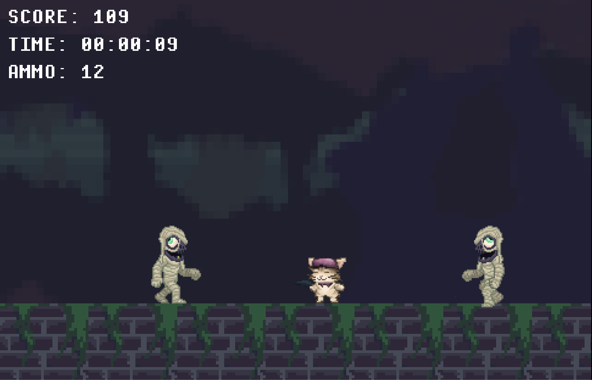
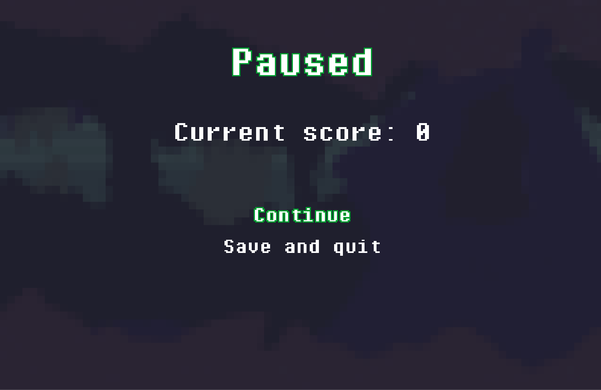
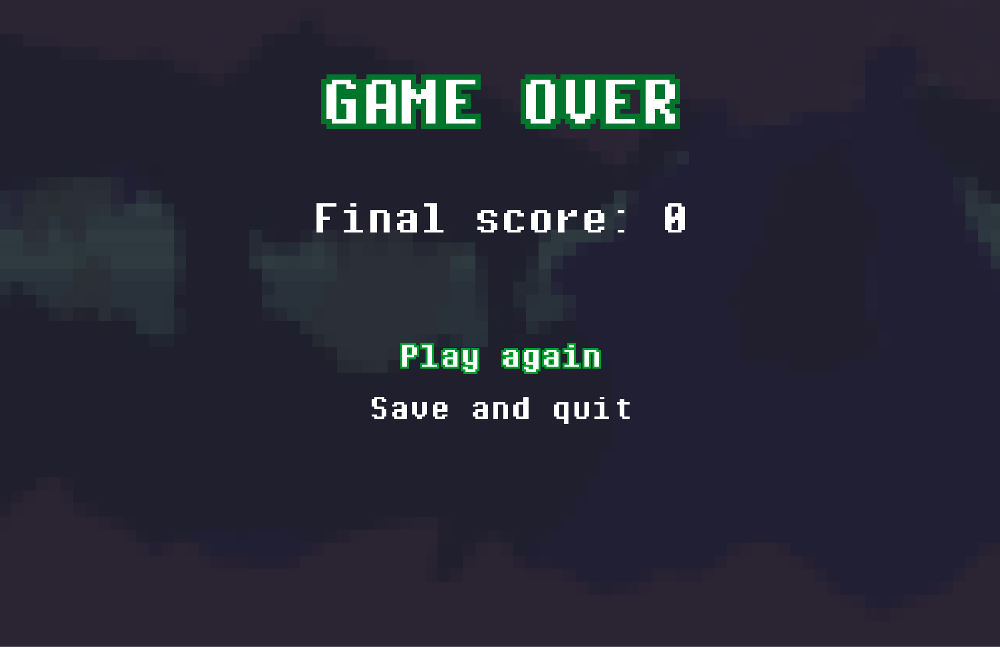
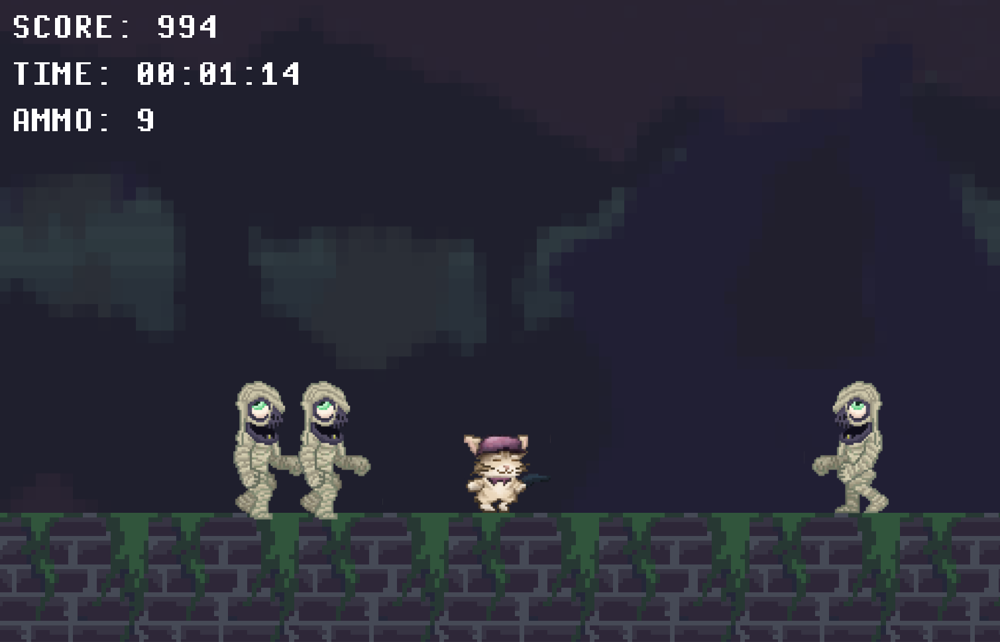
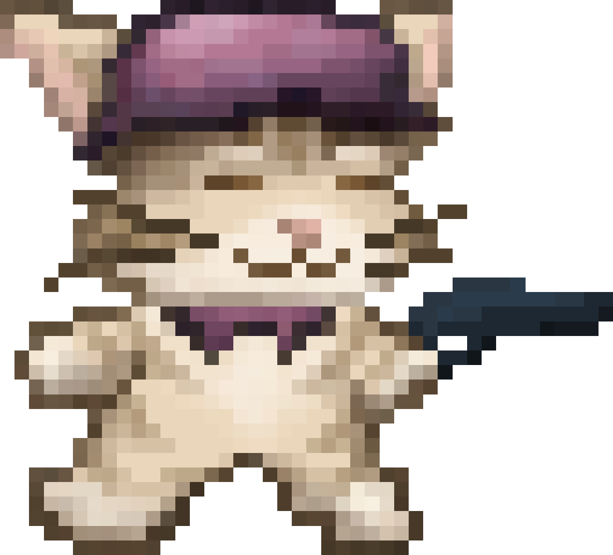
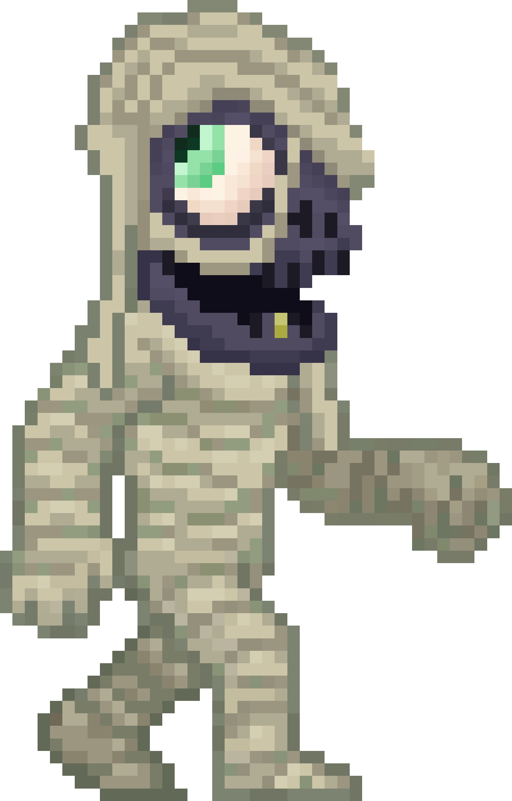
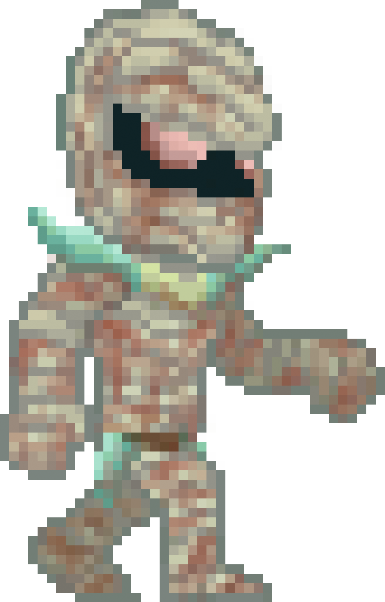

= Cave Mummies
:experimental:
:nofooter:
:source-highlighter: pygments
:stem: latexmath
:toc:
:xrefstyle: short

image:doc-assets/game_main_menu.png[Cave mummies main menu, align=center]

[[Game-lore]]
== Game Lore
Cave Mummies is a **2D arcade / survival** game that creates a fun and enjoyable
experience during gameplay, through **unlimited** gameplay with an infinite game
mode that features the main character **Wil**.
Wil is an anthropomorphic creature that appeared one day on his owner's
backyard as a baby. Since then, his owner has taken care of him.
Wil is stranded in a cave where his owner went missing. He's in the search for
him, but encounters himself surrounded by hordes of **mummies** that are
desperate to take him down.
Before Wil's owner went on searching for treasure in the caves, he left Wil a
gun so he could protect himself against any creature. Since it has been a while
since Wil has seen his owner, he starts his journey looking for him taking the
gun he was given.

Wil does not know when the hordes of mummies will stop, but he knows he has to
survive to see his owner again. Wil discovers they only perform
**melee attacks**, therefore he must take advantage of his ranged weapon.

== Game Specification
Cave Mummies is a single-player desktop video game which is built on C++ and
NASM (x86_64 Assembly). It utilizes Raylib as its base graphics library, and
relies on it for all graphic and input actions in the game. The game features
NASM in its Linux-based release. Therefore, performance may increase in 
Linux-based machines.

The core mechanic of the game is time-based survival with score progression.
The player is intended to survive as long as possible. Based on elapsed time and
the number of mummies defeated by the player, they will be rewarded with
a greater score. Scores have a specific scope: they are only the highest on
the current game application opened. Therefore, if the player wished to save
their progress, they should take a picture of the highest score recorded.

=== Key features
- Static arena gameplay
- Enemy waves with multiple difficulty levels (speed and resistance)
- Player's weapon with limited ammunition
- Elapsed time clock for game sessions
- Scoring system with high-score tracking
- Menu interface, with about page and highest score label

== How to Play

First of all, the player must navigate through the presented main
menu. The player can navigate the menu utilizing `W` / `UP` keys for going
**upward**, and `S` / `DOWN` keys for going **downward**. The player can select
an  option by pressing the `return` key or using the mouse `LEFT_CLICK` anywhere
on the screen.

These navigation instructions apply to **all** game menus presented during the
application's lifetime. Following these navigation instructions, the player
should select the `Start` option, which is first in the menu. Once the player
selects that option, the application will initiate gameplay.

The game provides the following control interface for the player to use:

- **Movement**: `W` / `A` / `D` or `UP_ARROW` / `LEFT_ARROW` / `RIGHT_ARROW`
keys
  (utilizing an arduino joystick can also toggle these key bindings)
- **Run**: `LEFT_SHIFT` key (to be used simultaneously with movement keys)
- **Jump**: `Space` bar, or `W` key, or `UP_ARROW` key
- **Reload**: `R` key or mouse `LEFT_CLICK`
- **Shoot**: Mouse `LEFT_CLICK`
- **Pause**: `Esc` key (used while in gameplay)
- **Music**: `M` key toggles the music

The player must aim at incoming enemies which will try to follow him / her, and
**shoot** them to take them down. Surely shooting with a weapon which has
unlimited bullets as ammunition is **satisfying**, but there is a limit to how
many bullets may be loaded into the weapon.
The weapon should only yield twelve bullets at a time. After the remaining
loaded bullets are used, the player must wait until the weapon is reloaded.
Reloading may take up to 2 seconds and can only occur once the magazine is
empty.

=== How to Win
To win the game is actually a matter of the player's want. The game by itself
does not have a finish line, or a proper end screen. Rather, the game continues
indefinitely until the player ultimately fails to avoid the incoming waves of
enemies, and dies.

To increase the current game score, only two factors can contribute to it:
time elapsed and enemies killed. Elapsed time, as its label implies, refers
to the time elapsed since the start of the gameplay. Each second elapsed
accounts for one extra point to the current game score. A greater enemy kill
count should grant a better score reward too. For each enemy killed, 10 points
are added to the current game score. The player starts out with only two jumps
available from the moment they are standing on the floor tile. Killing
enemies increases the amount of jumps the player can perform. This jump count
is cumulative and not capped, therefore, the player can store as many jumps
available, as enemies killed.

The player's goal is to survive as long as possible without being touched by any
enemy. The game score may indicate a degree of "winning", in the sense that a
higher score may indicate gamer prowess.

In both the paused menu, and game over screen, appear an option to go back to
the main menu. This option records the highest game score during the current
application's lifetime.

[[gameplay_summary]]
=== Gameplay Summary
The gameplay mechanics can be summarized in the key points of the following
list. The following list summarizes the main gameplay mechanics:

- Survive waves of enemies appearing from the sides of the stage
- Avoid not having any loaded bullets in the weapon
- Aim and shoot at enemies to survive
- Avoid direct contact with enemies
- The longer you stay alive, the higher your score
- Kill as many enemies to get a better score
- Wisely manage your accumulated jump count
- Staying in the air can prevent enemies from reaching you
- A high-score tracker records your best survival time

Finally, winning is not about finishing levels, but about setting and breaking
your personal best score.

[[assets]]
== Game Assets

=== Main Menu Screen
image::doc-assets/game_main_menu.png[Game main menu, align=center]

=== Paused Game Screen

=== Game Over Screen

=== Gameplay Example

=== Player Character

=== Enemy Set
==== Easy-Moderate Difficulty Enemy

==== Hard Difficulty Enemy

[[user_manual]]
== User Manual

[[build]]
=== Build

[[game_settings]]
==== Game settings
If you prefer to utilize a joystick for playing the game, change `line 28` using
the following syntax:
Otherwise, use `InputSourceType::Keyboard` for standard input with the keyboard.
[source,delphi]
----
Game game(cave_mummies::handlers::InputSourceType::Joystick);
----

[[build]]
==== Build
=== Disclaimer
Before attempting to build the project, make sure the required dependencies are
on your machine, and that their paths are reachable. Using `make help`
displays an interface with all available targets provided by the Makefile.
Make sure to follow the set interface.

The following indications are focused on MacOS and Linux-based systems
specifically. Support for machines with Windows operating system, or other
operating systems is not readily supported, nor there is documentation for
those systems relating to this project in this document.

=== Instructions
Previous to the main instructions, there is the `make raylib` command available,
which clones and compiles the raylib dependency for this project to compile
adequately.

Starting off, open a terminal window and direct yourself to the root of this
project. There, to build the game, run the `make` command. This action will
compile the source code in a directory named `build/` in the current project,
and link the compiled code into an executable named `Cave mummies` in a `bin/`
directory.

The previous target mentioned provides a standard debug compilation for the
game, but also a `make release` command is provided by the Makefile interface
to compile a release version of the game. This target will perform a similar
instruction pipeline to `make`, although the executable created is a more
optimized release version of the game.

To clear any compiled files and executables, utilize the `make clean`
command. This command will remove the `build/` and `bin/` directories in one
action, but will not remove the `libs/raylib/` directory.

During development, **cpplint** was used to enforce a consistent code standard.
If you have **cpplint** in your machine, you can utilize the `make lint`
command to perform a scan on the code. This functionality is an extra, and
is not necessary to compile and run the game.

[[usage]]
=== Usage
After the previous <<build, build>> section and the compilation
process, this section will provide a usage guide of the game.

The Makefile interface provides the `make run` command, which should be used
after having a compiled version of the game to run the game. If no compiled
executable is available, the target will compile the game in `debug` mode, in
the same manner the `make` command does.

Another alternative, is to direct yourself to the `bin/` directory in the root
of the project and executing the executable file manually. A desktop shortcut
can also be created using the executable located inside the `bin/` directory.

[[Functionality]]
== Functionalities
The following table of functionalities lists a series of functionality intended
to be included in the game.
[cols="2,2,2,2", options="header"]
|===
| Functionality | Control (keys/joystick) | Description | Status

| Lateral Movement
| `W` / `A` / `D` or `UP_ARROW` / `LEFT_ARROW` / `RIGHT_ARROW` keys
| The player moves across the screen.
| ✅ Finished

| Lateral Movement with Arduino joystick
| Joystick axis movement
| The player moves across the screen.
| ⏳ Pending

| Running
| `LEFT_SHIFT` key (to be used simultaneously with movement keys)
| Makes the player boost its current speed.
| ✅ Finished

| Jump
| `Space` bar, or `W` key, or `UP_ARROW` key
| Allows dodging mummies. Vertical movement only (jump).
| ✅ Finished

| Reloading
| `R` key or mouse `LEFT_CLICK`
| Reloads the player's weapon ammunition to the maximum value
| ✅ Finished

| Shooting
| Mouse `LEFT_CLICK`
| Shoots a bullet toward the position of the cursor.
| ✅ Finished

| Score
| Automatically with time and when eliminating mummies
| The current and highest score is saved in the game.
| ✅ Finished

| Menu Interface
| -
| The main menu that directs to gameplay and the about menu.
| ✅ Finished

| Game Interface
| -
| Load game scene, player, and enemy sprite textures.
| ✅ Finished

| Pause Button
| `Esc` key (used while in gameplay)
| Transition to a paused game state to pause the gameplay
| ✅ Finished

| Toggle soundtrack button
| `M` key
| Toggle playing the background soundtrack
| ✅ Finished

| High Score Component
| -
| A label / title in the main menu displaying the highest historical score.
| ✅ Finished
|===

== Dependencies
To compile the game utilizing its build features, the following dependencies
must be present on your machine:

- Latest gpass:[++] compiler
- NASM (Assembly compiler)
- Git (version control)
- CMake (build tool)

The g++ compiler is required since the Makefile only supports that compiler.
The NASM Assembly compiler is necessary for Linux-based builds due to the
Makefile establishing a rigid compilation pipeline. No need for it if you're
using a MacOS operating system.
Git version control is used to clone the raylib dependency.
CMake is used to compile the raylib clone.

All of these dependencies are to be installed suited to your operating system.
There is no guide on how to install these besides this requirement list.

[[credits]]
== Credits

=== Professor
mailto:sleyter.angulo@ucr.ac.cr[MSc. Sleyter Angulo Chavarría]

=== Developer
mailto:jason.montenegro@ucr.ac.cr[Jason Montenegro Navarro] | C4H386
