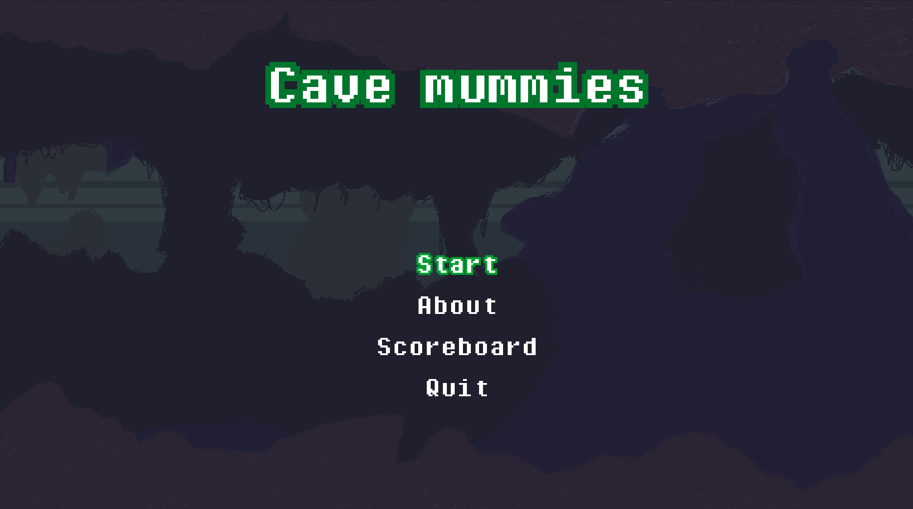
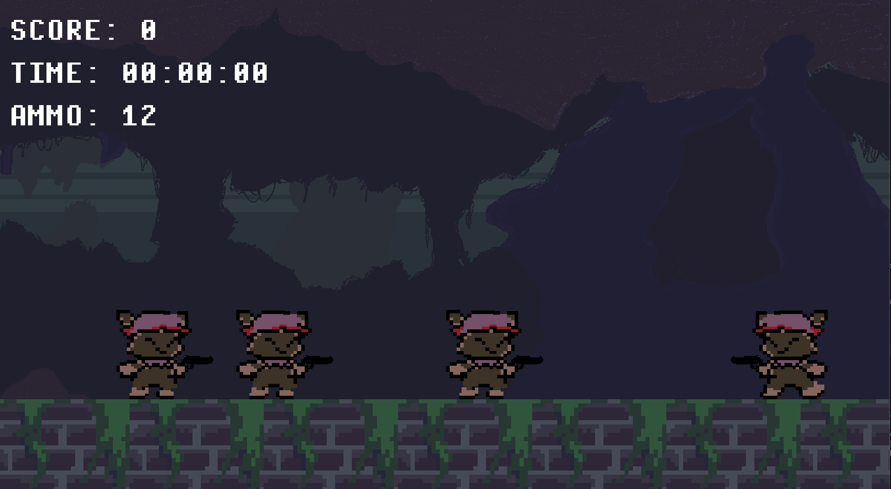
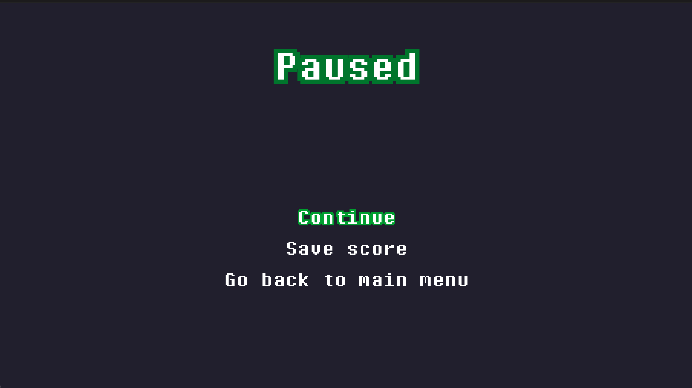
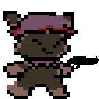

= Cave mummies
:experimental:
:nofooter:
:source-highlighter: pygments
:sectnums:
:stem: latexmath
:toc:
:xrefstyle: short

[[Game-lore]]
== Game Lore
Cave Mummies is a 2D arcade / survival game that creates a fun and enjoyable
experience during gameplay, through unlimited gameplay with an infinite game
mode that features the main character Wil.
Wil is an anthropomorphic creature which appeard one day on his owner's
backyard as a baby. Since then, his owner has taken care or him.
Wil is stranded in a cave where his owner went missing. He's in the search for
him, but encounters himself surrounded by hordes of mummies that are desperate
to take him down.
Before Wil's owner went on searching for treasure in the caves, he left Wil a
gun so he could protect himself against any creature. Since it has been a while
since Wil has seen his owner, he starts his journey looking for him taking the
gun he was given.

Wil does not know when the hordes of mummies will stop, but he knows he has to
survive to see his owner again. Wil discovers they only perform melee attacks,
therefore he must take advantage of his ranged weapon.

== Game specification
Cave Mummies is a single-player desktop video game which is built on C++ and
NASM (x86_64 Assembly). It utilizes Raylib as its base graphics library, and
relies on it for all graphic and input actions in the game. The game features
NASM in its Linux-based release. Therefore, performance may increase in 
Linux-based machines.

The core mechanic of the game is time-based survival with score progression.
The player is intended to survive as long as possible. Based on the time passed,
the player is rewarded with a better score on the specific game session it is
playing.

=== Key features
- Static arena gameplay
- Enemy waves with multiple difficulty levels (speed and resistance)
- Player's weapon reloading
- Scoring system with high-score tracking
- Menu interface and scoreboard

== How to play

The player must open the application and navigate through the presented main
menu. The player can navigate the menu utilizing `W` / `UP` keys for going
upward, and `S` / `DOWN` keys for going downward. The player can select an 
option by pressing the `return` key.

Following these navigation instructions, the player should select the 'Start'
option, which is first in the menu. Once the player enters that option, the
application should initiate gameplay.

The game provides the following control interface for the player to use:

- **Movement**: A / D / W / UP_ARROW / LEFT_ARROW / RIGHT ARROW keys 
(or joystick with Arduino)
- **Run**: LEFT-SHIFT key (its used simultaneously with movement keys)
- **Jump**: Space bar
- **Reload**: R key
- **Shoot**: Mouse left-click
- **Pause**: ESC key pauses the active game
- **Music** M key toggles the music

The player will have unlimited bullets as ammunition, but there is a limit to
how many bullets may be loaded onto the weapon. Therefore, the weapon will
yield twelve bullets at a time. After the remaining loaded bullets are used,
the player must wait until the weapon is reloaded. Reloading the weapon can be
done with the `R` key, and it may take up to 2 seconds.

The player must aim at incoming enemies which try to follow the player, and
shoot at them to take them down utilizing the mouse `left-click`. The player is
able to move left and right, run and jump. Finally to pause the game, the player
can enter a pause state, to which an options menu will appear for the player
to choose from.

=== How to win
To win the game is actually a matter of the player's want. The game by itself
does not have a finish line, or a proper end screen. Rather, the game continues
indefinitely until the player ultimately fails to avoid the incoming waves of
enemies, and dies.

To increase the current game score, three factors can contribute: time elapsed,
enemies killed, and air time. Time elapsed as its label implies, it refers to
the time elapsed since the start of the game. Enemies killed can vary between
the difficulty of the enemies. More difficult enemies tend to yield a better
score for killing them. The player has two jumps available from the moment
its standing on the floor tile. Killing enemies increases the amount of
jumps the player can perform, therefore, staying in the air increments the score
rapidly if the player is able to stay in the air the most time possible.

The player's goal is to survive as long as possible without being touched by any
enemy. The game score may indicate a degree of "winning", in the sense that a
higher score may indicate gamer prowess.

Saved historial scores are to be tracked by the game, and will be displayed at
the player's wish in the main menu. 
A scoreboard shall appear with the historical best scores in the game.

The indications summary following the next list:

- Survive waves of enemies appearing from the sides of the stage.
- Avoid not having any loaded bullets in the weapon.
- Aim and shoot at enemies to survive.
- Avoid direct contact with enemies.
- The longer you stay alive, the higher your score.
- Staying in the air yields a constant amount of score points.
- Do not let enemies get near you.
- A high-score tracker records your best survival time.

Finally, winning is not about finishing levels, but about setting and breaking
your personal best score.

[[assets]]
== Game assets

=== Main menu

=== Paused menu

=== Main character

[[user_manual]]
== User manual

[[build]]
=== Build

[[game_settings]]
==== Game settings
If you prefer to utilize a joystick for playing the game, change `line 10` using
the following syntax:
Otherwise, use `InputSourceType::Keyboard` for standard input with the keyboard.
[source,delphi]
----
Game game(InputSourceType::Joystick, "Cave Mummies");
----

[[building_the_program]]
==== Building the program
Before attempting to build the project, make sure the required dependencies are
on the clients machine, and are their paths are reachable.
Using `make help` provides an interface for all available targets in the
Makefile provided, make sure to follow the set interface.

The following indications are focused on MacOS and Linux-based systems
specifically. Support for machines with Windows, or other operating systems is
not supported, nor there is documentation for those systems relating to this
project.

Open a terminal window, and direct to the root of this project. There, to build
the game input the `make` command. This action will compile the source code into
object code in a `build/` directory in the current project and link all that
object code into an executable named `Cave mummies` in a `bin/` directory.

The previous Makefile target provides a standard compilation for the game, but
also a `make release` command is provided by the Makefile interface, to compile
a release version of the game. This target will perform a similar pipeline to
`make`, although the executable created is a release version of the game.

Another useful command, but rather similar to `make` is the `make debug`
command, which is intended to build a debug version of the game. This version
is intended for debugging the program's code.

To clear any compiled files and generated executables, utilize the `make clean`
command. This command will eliminate the `build/` and `bin/` directories in one
action.

During development cpplint was utilized for following a set standard in the
code. If you have cpplint in your machine, you can utilize the `make lint`
command to perform a scan on the code. This functionality is an extra, and
should not be necessary for compiling and running the program.

[[usage]]
=== Usage
After the previous `build` section, and compiling an executable version of the
game, this section will provide a guide on usage of the program.

The Makefile interface provides the `make run` command, which should be used
after having a compiled version of the program. If no compiled executable is
available, the target will compile the game the same way the `make`
command does. And after that, it will run the program.

Another alternative, is to direct to the `bin/` directory in the root of the
project and running the program using the mouse.
This alternative is discouraged because the game assets may go missing and the
program may behave in a weird way.

[[Functionality]]
== Functionality
The following functionalities are intended to be included in the video game.
[cols="2,2,2,2", options="header"]
|===
| Functionality | Control (keys/joystick) | Description | Status

| Lateral Movement
| With Arduino: Joystick Without Arduino: left key A, right key D
| The player moves sideways across the screen.
| ✅ Finished

| Running
| Left-shift key (should be used in conjuction with movement keys)
| Makes the player increment its speed.
| ✅ Finished

| Jump
| Space key
| Allows dodging mummies. Vertical movement only (jump).
| ✅ Finished

| Reloading
| R key
| Increases available ammunition.
| 🔄 In progress

| Shooting
| Mouse (left click)
| Shoots a bullet toward the position of the cursor. Impact reduces enemies
health points.
| ✅ Finished

| Score
| Automatically with time and when eliminating mummies
| The highest score is saved.
| 🔄 In progress

| Menu Interface
| -
| The main menu that directs to a game session and the report.
| ✅ Finished

| Game Interface
| -
| Sprites of the player and enemies must appear on screen.
| ✅ Finished

| Pause Button
| Esc key
| Pressing Esc key pauses the current game session.
| ✅ Finished

| Toggle soundtrack button
| M key
| Pressing M key toggles the playing soundtrack.
| ✅ Finished

| High Score Component
| -
| A component in the main menu displaying the highest historical score.
| 🔄 In progress
|===

== Dependencies
For the client to compile the game utilizing its build features, the following
dependencies must be present in the clients machine:

- Latest gpass:[++] compiler
- NASM Assembly compiler
- System-specific Raylib Graphics library

The g++ compiler is required due to the Makefile only providing an interface for
 that specific compiler.
The NASM Assembly compiler is necessary for Linux-based builds due to the
Makefile establishing
a rigid compilation pipeline.
The Raylib Graphics library is required, as its the backbone of the game, in
which it relies heavily for all the graphic and input actions.

[[credits]]
== Credits

=== Professor
mailto:sleyter.angulo@ucr.ac.cr[MSc. Sleyter Angulo Chavarría]

=== Developer
mailto:jason.montenegro@ucr.ac.cr[Jason Montenegro Navarro] | C4H386
